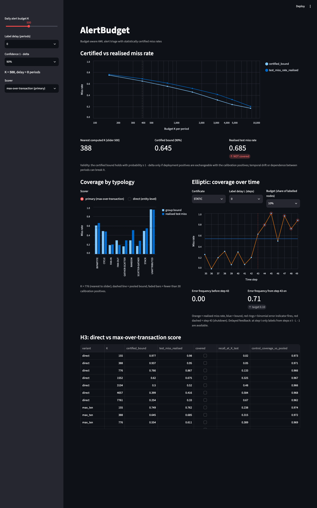
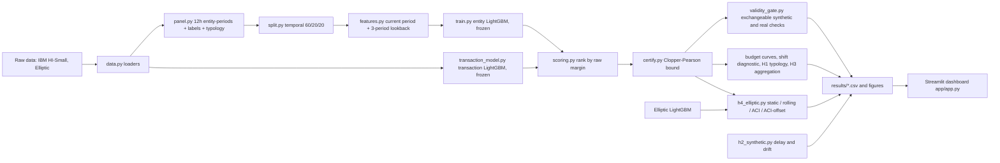

# AlertBudget

Budget-aware AML alert triage with statistically certified miss rates

## What this is

AlertBudget ranks accounts by money-laundering risk and, for a fixed daily review capacity K, attaches a statistical certificate to the ranking: with confidence 1 - delta, no more than a stated share of the truly suspicious accounts is missed. It is a small end-to-end research project on public data (IBM synthetic AML transactions and the Elliptic bitcoin graph) covering the scorers, the certificate, a validity gate, drift experiments with delayed feedback and adaptive recalibration, and a Streamlit dashboard. The main point is honest: the certificate is exact when positives are exchangeable and fails under drift, and the repo measures both.

## The problem

A bank can only review K alerts a day, so the useful question is not "what is the AUC?" but "if we review the top K, how many suspicious entities do we miss, and how sure are we?". Here the miss rate is the share of positive account-periods that fall outside the top K. A one-sided Clopper-Pearson bound on calibration positives gives a certified upper bound on it. The bound is valid only if deployment positives are exchangeable with the calibration positives; temporal drift and dependence between consecutive periods can break that.



## Key results

Numbers below are generated by `src/make_readme_numbers.py` from the CSVs in `results/` (not typed by hand).

| Result | Number | Source |
|---|---|---|
| Valid when exchangeable, broken by time (IBM, primary scorer, delta 0.10) | 18/18 gate configurations pass (synthetic coverage 0.914-0.968 vs nominal 0.90/0.95), but on the temporal split the bound covers the realised test miss at 0/7 budgets (realised minus bound +0.013 to +0.097) | results/validity_gate.csv; results/miss_rate_certified_vs_realised.csv |
| Aggregation (max over transactions vs direct), K = 1% of period | recall 0.483 vs 0.325; exchangeable-control coverage 0.964-0.995 (valid) | results/h3_aggregation.csv (recall_at_K_test, control_coverage_vs_pooled) |
| Group-conditional (H1, primary scorer, delta 0.10) | UNATTRIBUTED miss 0.36-0.94 vs pooled bound 0.17-0.55; pooled-bound exchangeable coverage 0.00 | results/coverage_by_typology_primary.csv |
| Elliptic shutdown (L = 2, q = 10%): error frequency before -> from step 43 | static 0.00 -> 0.71; rolling 0.12 -> 0.86; aci 0.12 -> 0.86; aci_offset 0.12 -> 0.86 (target 0.10; recovery lag at L = 2, q = 10%: static none, rolling none, aci none, aci_offset none) | results/h4_elliptic_summary.csv |
| Label delay (synthetic, delta 0.10) | control d=0: 0.916-0.920; slow drift d=0.01: L=0 0.753, L=2 0.603, L=4 0.504 | results/h2_synthetic_delay.csv (coverage, t = all) |

## Architecture



## How to run

```bash
python -m venv .venv && source .venv/bin/activate && pip install -r requirements.txt
DATA_DIR=/path/to/dataset/folder ./run_all.sh --quick     # 15% account sample, minutes; drop --quick for the full run
streamlit run app/app.py
```

`DATA_DIR` must hold the seven dataset files (`HI-Small_Trans.csv`, `HI-Small_accounts.csv`, `HI-Small_Patterns.txt`, `SAML-D.csv`, `elliptic_txs_*.csv`); the default is `data/raw/`. Quick mode writes to `results_quick/` and never touches the committed `results/`. Run `pytest` afterwards (use `ALERTBUDGET_MODE=quick pytest` after a quick run).

## What I'd do for production

- **Shadow mode for selective labels.** In deployment only reviewed alerts get labels, so the miss rate of unreviewed entities is unobserved. Run the model in shadow mode (label a random slice outside the top K) to get unbiased miss-rate estimates.
- **Volume-conditioned budgets.** Fixed review counts reviewed very different shares of entities in busy and quiet periods; budget as a share of volume, or condition the certificate on volume, and compare against the fixed-count definition used here.
- **A higher-authority adaptation rule.** Adapting the confidence level has almost no authority over a jump in miss rate (see `results/bound_vs_delta.csv`), and an additive-offset rule helped only partly; production needs a drift detector (for example CUSUM on the error indicator) that triggers recalibration on fresh labels, and a bound that can widen fast.

## Limitations

- Public synthetic data: the IBM generator stops normal traffic after 2022-09-10 and the project uses only the regular-volume window; results say nothing about a real bank.
- Positives are not exchangeable over time: the certified bound under-covers on the temporal split at every budget, and no adaptation arm restored coverage on the Elliptic shutdown.
- A large share of laundering is not tied to any listed typology (UNATTRIBUTED), and the pooled certificate under-serves exactly that group.
- Entity-periods of the same account are dependent and accounts overlap across splits (about 71% of accounts appear in more than one split).
- Elliptic post-shutdown steps contain very few illicit nodes, so per-step error indicators there are noisy.
- Many (typology, budget) cells were examined (36 per scorer and delta); about 10% would miss by chance at delta = 0.10.
- The transaction model leans on payment format (ACH), a generator pattern.
- The validity-gate specification was corrected after its first run (a bound cannot reach nominal coverage against another sample's observed rate); see Technical notes.
- Full list: `report/limitations_checklist.md`.

## Dataset notes

- **IBM AML HI-Small:** 5,078,345 transactions over 2022-09-01 to 2022-09-18, 5,177 laundering rows (0.10%). After 2022-09-10 normal traffic nearly vanishes, so only transactions before 2022-09-11 are used (655 laundering rows dropped). `HI-Small_Patterns.txt` lists 370 laundering attempts in 8 typologies; 1,968 of the 5,177 laundering transactions belong to no attempt.
- **Elliptic:** 203,769 transactions, 49 time steps, 165 anonymised features; 46,564 are labelled illicit or licit and the rest are unknown and excluded. The dark-market shutdown at step 43 is the drift event.
- **SAML-D** loads but is out of scope.

## Exploratory additions after the first freeze

The main results were frozen at the git tag `results-frozen`. These three additions were made AFTER seeing those results, so treat them as exploratory (tag `results-frozen-v2`):

- **Finer H2 drift grid (d = 0.005, 0.01, 0.02).** Reason: with d >= 0.05 coverage collapsed even at zero delay (a floor effect), so the dose-response in label delay could not be seen. Rows are marked `grid = extended_post_hoc` in `results/h2_synthetic_delay.csv`.
- **Additive-offset ACI arm on Elliptic ("ACI-offset (post-hoc)").** Reason: the Clopper-Pearson bound depends only logarithmically on delta, so adapting delta has little authority over a jump in miss rate (`results/bound_vs_delta.csv`). Its outcome is reported in `results/h4_summary.md`, whatever it showed.
- **H1 rerun on the primary scorer.** Reason: the primary scorer was chosen after H1 was first run on the entity-level scorer. Output: `results/coverage_by_typology_primary.csv` and `results/h1_summary.md`; the original direct-scorer file is kept.


## Technical notes

### Data and modelling choices

- **Entity-period.** Entity = account key (bank id as integer + account). A row exists for each account that sends or receives at least one transaction in a period. Periods are 12-hour blocks (the regular-volume window has only 10 days, fewer than 14), giving 20 periods. Label = 1 if any laundering transaction involves the account in that period, as sender or receiver.
- **Window.** The IBM HI-Small generator stops emitting normal traffic after 2022-09-10 (under 500 transactions per day versus 200k-1.1M) while laundering rows keep trickling in, so only transactions before 2022-09-11 are used (`ACTIVE_END` in `src/config.py`). This drops 655 of 5,177 laundering rows.
- **Typology.** Used for grouping and reporting only, never as a feature. For a positive entity-period it is the most frequent typology among the pattern attempts the account takes part in during that period (ties: earliest attempt). `UNATTRIBUTED` marks positives whose laundering transactions belong to no attempt in `HI-Small_Patterns.txt`; about 46% of positive entity-periods.
- **Split.** Strictly temporal by period order: train periods 0-11, calibration 12-15, test 16-19, never shuffled. The largest connected component holds 72% of accounts (under the 90% threshold) but spans every period, so keeping whole components in one split cannot coexist with an order-based split; accounts therefore overlap across splits (71% appear in more than one).
- **Features (v2, current).** For entity-period t: features from all transactions in period t (the review happens after t closes, so they are legitimately available) plus the same set over the trailing 3 periods before t, a `has_history` flag, and current/lookback ratios (transaction count, out-degree, total amount). Lookback features are NaN, not zero, when there is no history. Nothing after the end of period t is used, and the label and typology are never read (the feature code drops them on entry; tests cover future deletion, label shuffling and a hand-built graph). Amounts are log1p-transformed and standardised per currency with train-split statistics only.
- **Ablation (v1).** v1 used only the 3 periods before t (lookback-only) and reached test ROC-AUC 0.61. Its metrics are kept in `results/day1_model_metrics_v1_lookback_only.json` and its model in `results/lgbm_v1_lookback_only.joblib` (git-ignored) for the report.
- **pandas pin.** `pandas>=2.2,<3` (currently 2.3.3).

### Certification

- **Reviewed set / miss.** In each period the top K entity-periods by score are reviewed (K is an absolute count per period). A positive entity-period is *missed* if it is outside its period's top K. Miss rate (false omission rate) = missed positives / all positives. Entities are ranked by the frozen model's raw margin (log-odds, `margin` in `scores.parquet`), not by probability; residual exact ties are broken by one seeded shuffle of the table (`src/scoring.py`) and then by input position (`src/certify.py`).
- **Certificate.** From the calibration positives, `certify` returns the exact one-sided Clopper-Pearson upper bound on the true miss rate at confidence 1 - delta (primary delta = 0.10, also 0.05).
- **Validity condition.** The bound holds with probability at least 1 - delta only if positives seen at deployment are exchangeable with the calibration positives. Temporal drift and dependence between consecutive periods for the same account can break this; H2 and H4 test that later.
- **Validity gate.** `python -m src.validity_gate` simulates exchangeable data with a known truth (1,000 trials per configuration) and halves the real calibration positives; it writes `results/validity_gate.csv` and `results/figures/validity_gate.png` and prints PASS or FAIL (realised coverage must be at least nominal - 2 SE).
- **Budget curve.** `python -m src.run_budget_curve` certifies on the calibration split and compares with the realised miss rate on the test split, writing `results/miss_rate_certified_vs_realised.csv` and `results/figures/budget_curve.png`.

